# SIPALUTER – Sistem Penentuan Lulusan Terbaik

  

SIPALUTER adalah aplikasi web untuk membantu SMA Negeri 1 Mandirancan memilih siswa yang layak mendapat predikat **Lulusan Terbaik**. Perhitungannya memakai metode **SMART (Simple Multi Attribute Rating Technique)**. Jadi penilaian tidak lagi dihitung manual satu per satu, tapi berdasarkan kriteria dan bobot yang sudah ditentukan sekolah.

Aplikasi ini dibuat dengan CodeIgniter 3, MySQL, dan template AdminLTE.

---

## Cara Kerja Singkat

1. Operator menentukan kriteria penilaian beserta bobotnya.
2. Setiap kriteria punya sub kriteria (rentang nilai) dengan skor 0 sampai 100.
3. Wali kelas mengisi nilai raport, ujian sekolah, dan presensi. Wakasek mengisi nilai ekstrakurikuler dan prestasi.
4. Sistem menghitung skor akhir: **nilai sub kriteria × bobot normalisasi**, lalu dijumlahkan untuk semua kriteria.
5. Siswa dengan skor **75 – 100** berstatus **diterima**, sedangkan skor **0 – 74** berstatus **ditolak**.
6. Hasilnya diurutkan dari skor tertinggi (ranking) dan bisa dicetak sebagai laporan.

### Kriteria Bawaan

| Kriteria                  | Bobot | Normalisasi |
| ------------------------- | :---: | :---------: |
| Nilai Rata-rata Raport    |   4   |     0.4     |
| Nilai Ujian Sekolah       |   3   |     0.3     |
| Nilai Ekstrakurikuler     |   1   |     0.1     |
| Nilai Prestasi            |   1   |     0.1     |
| Nilai Presensi Kehadiran  |   1   |     0.1     |

Kriteria dan bobotnya bisa diubah kapan saja oleh operator. Bobot normalisasi akan dihitung ulang otomatis.

---

## Hak Akses Pengguna

Ada empat jenis pengguna, dan menu yang muncul menyesuaikan perannya masing-masing.

| Peran              | Yang bisa dilakukan |
| ------------------ | ------------------- |
| **Operator**       | Kelola kriteria, sub kriteria, tahun akademik, kelas, data siswa, data user, melihat hasil penilaian dan laporan |
| **Wali Kelas**     | Kelola data siswa, input nilai raport, ujian sekolah, dan presensi |
| **Wakasek**        | Kelola data siswa, input nilai ekstrakurikuler dan prestasi |
| **Kepala Sekolah** | Melihat data siswa, hasil penilaian, dan mencetak laporan |

---

## Fitur

### 1. Login
Setiap pengguna masuk dengan username dan password. Setelah login, sistem langsung mengarahkan ke dashboard sesuai hak aksesnya.

### 2. Dashboard
Menampilkan ringkasan jumlah data siswa, kriteria, kelas, dan user. Di bawahnya ada grafik jumlah siswa per kelas.

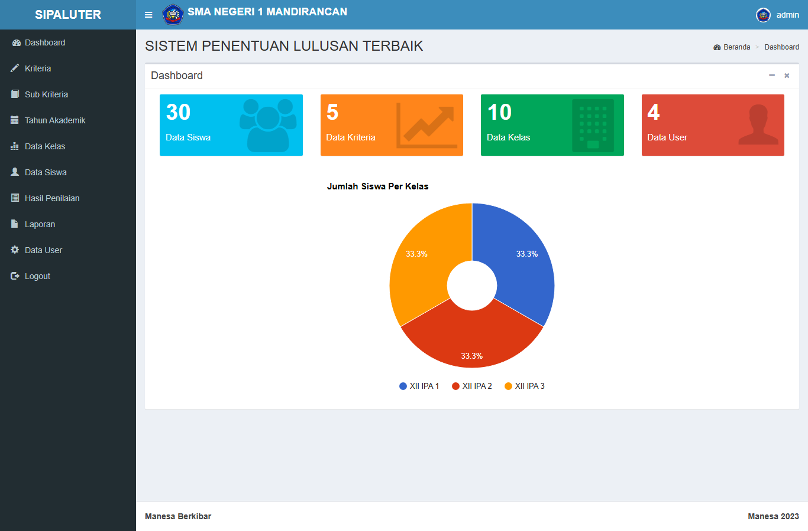

### 3. Data Kriteria
Tempat menambah, mengubah, dan menghapus kriteria penilaian. Saat bobot diisi, sistem otomatis menghitung bobot normalisasinya sehingga totalnya selalu 1.

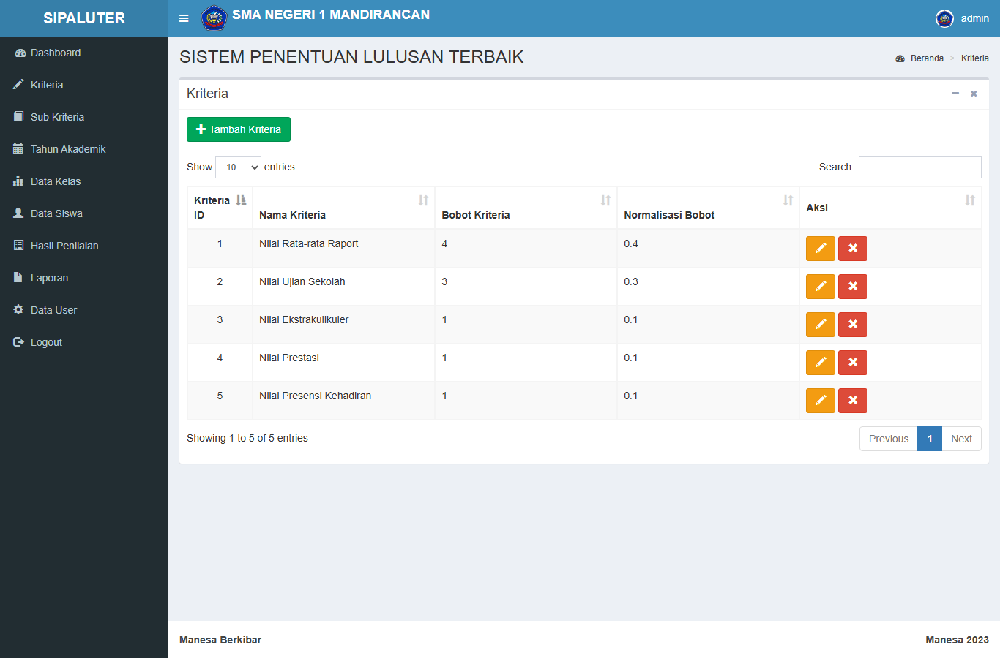

### 4. Data Sub Kriteria
Setiap kriteria dipecah lagi menjadi beberapa tingkat. Contohnya untuk nilai raport: ≥ 91 dapat skor 100, 86–90 dapat 75, dan seterusnya sampai ≤ 75 dapat 0.

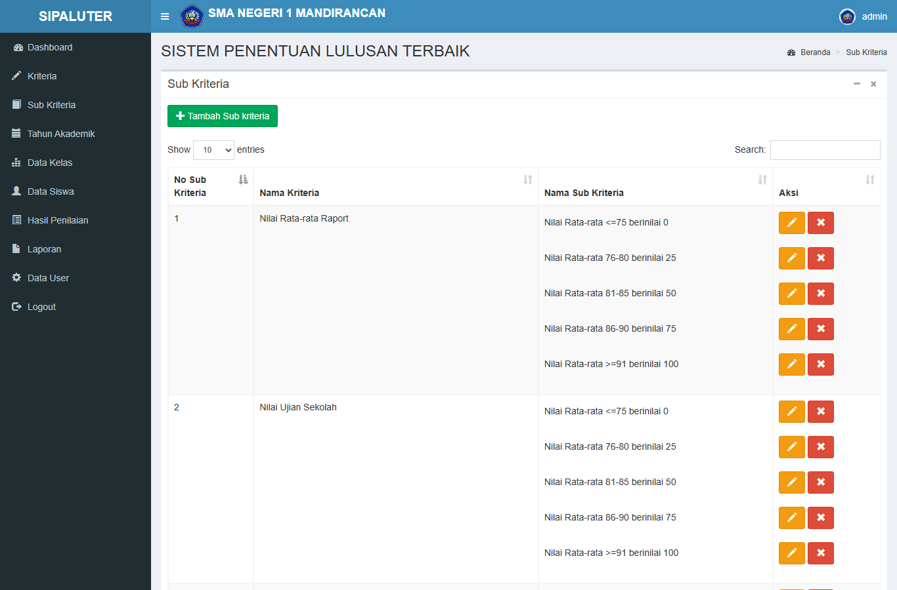

### 5. Tahun Akademik
Mengatur tahun ajaran. Hanya satu tahun yang bisa aktif, dan data penilaian yang tampil mengikuti tahun yang sedang aktif.

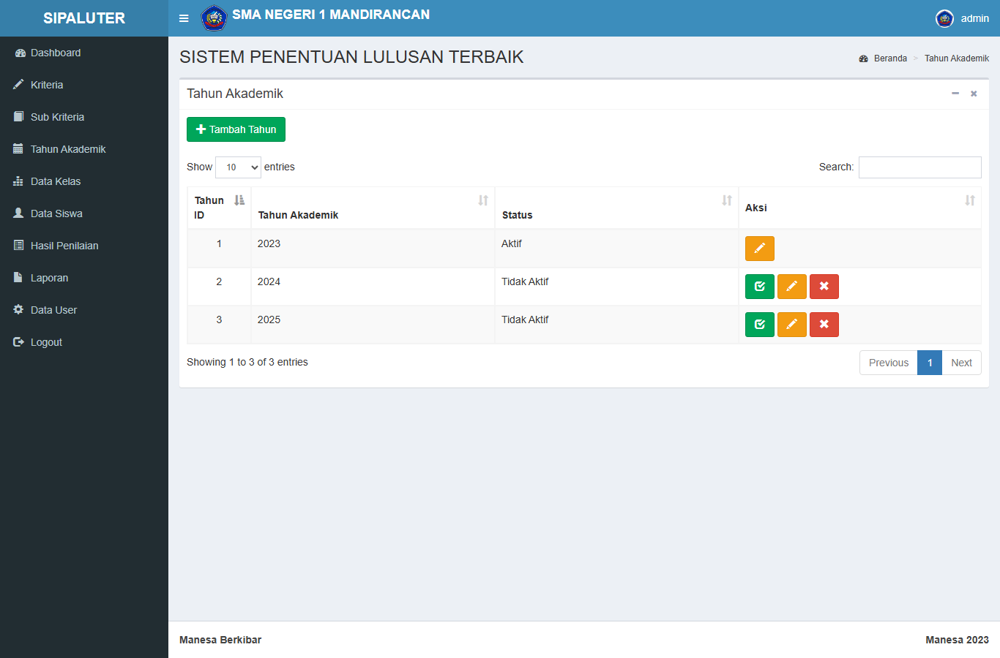

### 6. Data Kelas
Mengelola daftar kelas yang nantinya dipakai untuk mengelompokkan siswa.

### 7. Data Siswa
Menyimpan data siswa berupa NISN, nama, dan kelas. Data bisa ditambah, diubah, dihapus, dan diekspor ke Excel.

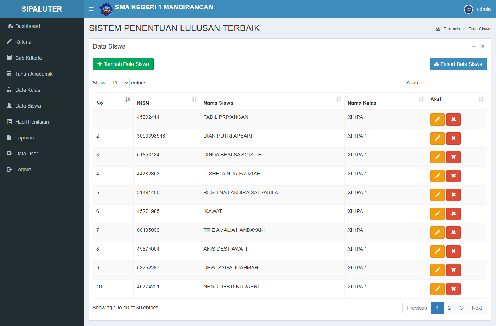

### 8. Penilaian
Penilaian dibagi sesuai peran. Wali kelas mengisi nilai akademik dan kehadiran, sedangkan wakasek mengisi nilai ekstrakurikuler dan prestasi. Daftarnya menampilkan nilai yang sudah masuk untuk tiap siswa.

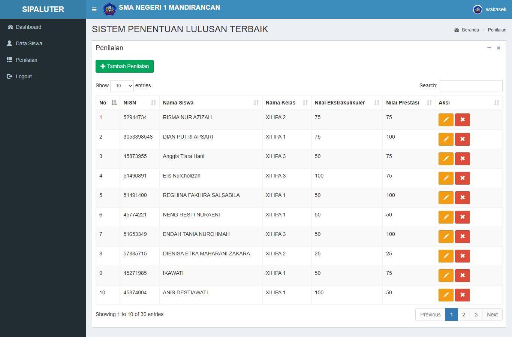

Untuk menambah nilai, cukup pilih siswa yang belum dinilai lalu pilih sub kriteria dari dropdown. Siswa yang sudah dinilai tidak muncul lagi di pilihan, jadi tidak ada data dobel.

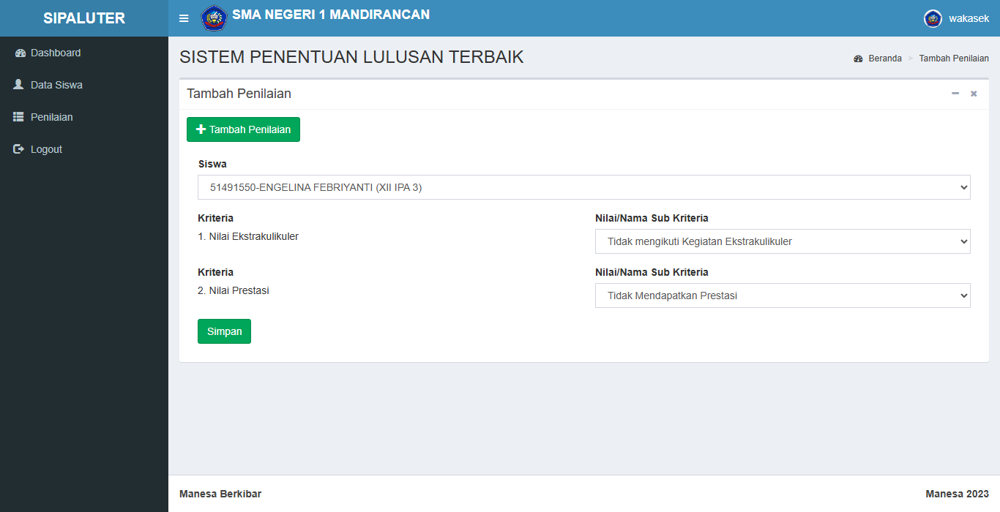

### 9. Hasil Penilaian
Menampilkan nilai setiap siswa per kriteria beserta bobotnya, skor akhir, dan ranking. Data sudah urut dari skor tertinggi. Kolom filter dipakai untuk menampilkan sejumlah siswa teratas saja, misalnya 10 besar.

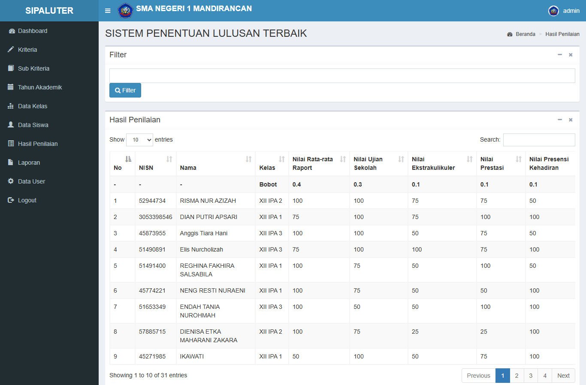

### 10. Laporan
Masukkan jumlah lulusan terbaik yang mau dicetak, lalu klik Cetak.

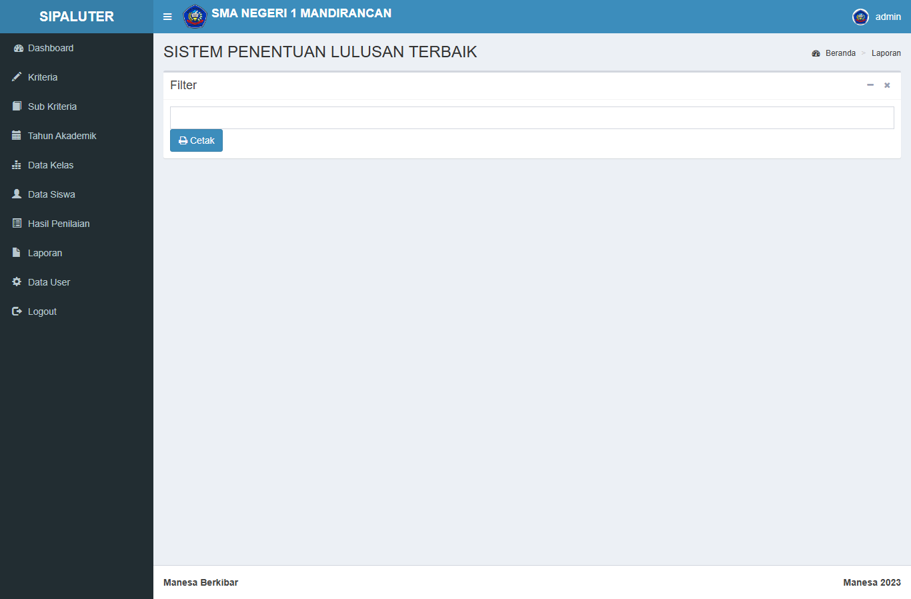

Hasilnya berupa PDF dengan kop Dinas Pendidikan Jawa Barat dan SMA Negeri 1 Mandirancan, berisi daftar lulusan terbaik lengkap dengan nilai, skor akhir, dan ranking.

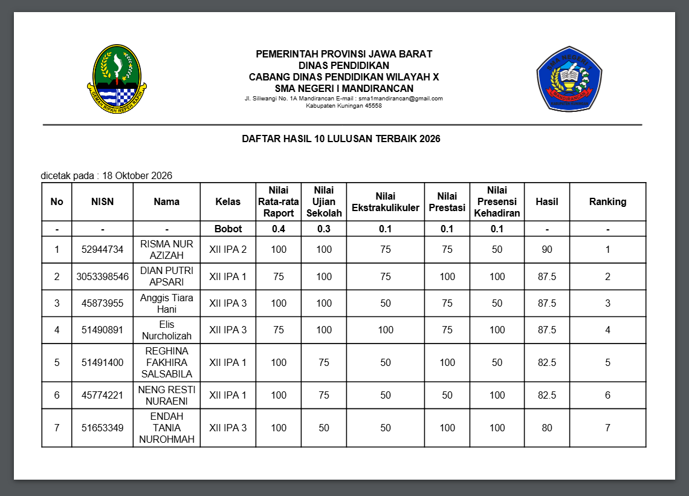

### 11. Data User
Operator bisa menambah, mengubah, atau menghapus akun pengguna sekaligus menentukan perannya.

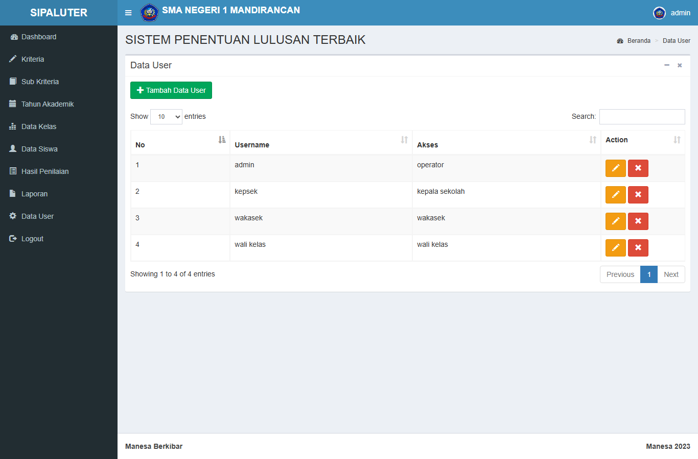

---

## Teknologi yang Dipakai

- PHP dengan framework CodeIgniter 3
- MySQL / MariaDB
- AdminLTE + Bootstrap
- DataTables untuk tabel
- Google Charts untuk grafik dashboard
- Dompdf untuk cetak PDF
- PHPExcel untuk ekspor Excel

---

## Lisensi

Proyek ini menggunakan lisensi MIT. Detailnya ada di file [LICENSE](LICENSE).
